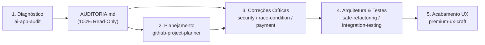

# 🪩 skillEletrohits

[](LICENSE)
[](#-catálogo-de-skills)
[](#-como-instalar-em-1-minuto)

**Transforme seu assistente de IA em um time de Staff Engineers, AppSec e Product Designers.**

Aplicações criadas rapidamente com IA costumam esbarrar nos mesmos gargalos invisíveis: políticas de banco expostas (RLS), regras financeiras no frontend, *race conditions* em estoque/cupons, webhooks duplicados, arquivos monolíticos e interfaces genéricas que quebram no primeiro erro.

O **skillEletrohits** é uma biblioteca aberta e padronizada de **Skills** (instruções de engenharia sob demanda) pronta para conectar em segundos às principais IDEs e agentes de IA:
- **Google Antigravity** (Desktop, CLI e Extensão)
- **Android Studio** (Gemini / Antigravity Agent)
- **IntelliJ IDEA / JetBrains** (AI Assistant / Junie)
- **Claude Code**
- **Cursor** / **Windsurf** e editores compatíveis com regras em Markdown

---

## 🧭 Como as Skills Trabalham Juntas

Você pode usar cada skill de forma isolada ou seguir o fluxo completo de **Auditoria → Planejamento → Correção → Acabamento**:



---

## 📚 Catálogo de Skills

> 💡 *Tabela atualizada automaticamente via GitHub Actions sempre que uma skill é adicionada ou editada.*

<!-- AUTO_SKILLS_TABLE:START -->
| Skill | Descrição | Arquivo |
| :--- | :--- | :--- |
| 🪩 `ai-app-audit` | Use esta skill para realizar uma auditoria geral panorâmica e 100% somente-leitura (read-only) de toda a aplicação web construída com IA, gerando o relatório AUDITORIA.md com diagnóstico de testes, segurança no cliente, race conditions, idempotência e arquitetura. | [`SKILL.md`](skills/ai-app-audit/SKILL.md) |
| `github-project-planner` | Atua como Tech Lead e Project Manager lean. Estrutura projetos no GitHub analisando issues e milestones existentes, organizando entregas em fatias verticais de alta densidade em português (prontas para humanos ou agentes de IA) e automatizando a criação/edição via gh CLI ou GitHub API. | [`SKILL.md`](skills/github-project-planner/SKILL.md) |
| `integration-testing` | Use esta skill para cobrir fluxos críticos do app (cadastro, autenticação, checkout, webhooks, pagamentos e permissões) com testes de integração realistas (estilo request specs), utilizando banco de teste real e mockando apenas serviços externos. | [`SKILL.md`](skills/integration-testing/SKILL.md) |
| `payment-idempotency` | Use esta skill para auditar, implementar e garantir idempotência em webhooks e endpoints de pagamento, cobrança, liberação de planos, créditos ou reembolsos (Stripe, Pagar.me, Asaas, Mercado Pago, etc.). | [`SKILL.md`](skills/payment-idempotency/SKILL.md) |
| `premium-ux-craft` | Use esta skill ao auditar, projetar ou codificar interfaces e fluxos de usuário, garantindo acabamento premium, ergonomia cognitiva, matriz completa de estados (empty, loading, error), teatro do sistema e recuperação graciosa de falhas. | [`SKILL.md`](skills/premium-ux-craft/SKILL.md) |
| `race-condition-audit` | Use esta skill para identificar, auditar, prevenir e corrigir race conditions (condições de corrida) em operações críticas como criação de pedidos, baixa de estoque, cupons, saldos, vagas, convites ou contadores. | [`SKILL.md`](skills/race-condition-audit/SKILL.md) |
| `safe-refactoring` | Use esta skill quando o usuário pedir para refatorar, modularizar ou dividir arquivos grandes ou monolíticos ("God files", telas ou rotas gigantes) em camadas limpas, sem alterar o comportamento existente e com testes de caracterização. | [`SKILL.md`](skills/safe-refactoring/SKILL.md) |
| `security-audit` | Use esta skill para realizar auditorias de segurança fullstack, identificando regras de negócio expostas no frontend (preço, descontos, permissões), vazamento de chaves e segredos em variáveis públicas (NEXT_PUBLIC_, VITE_), e brechas de Row Level Security (RLS) no Supabase ou bancos expostos por API. | [`SKILL.md`](skills/security-audit/SKILL.md) |
<!-- AUTO_SKILLS_TABLE:END -->

> **Nota sobre Escopo**: As skills de auditoria, testes e pagamentos (`ai-app-audit`, `security-audit`, `race-condition-audit`, `payment-idempotency`, `integration-testing`) são otimizadas para **aplicações Web / Fullstack / SaaS** (Next.js, Supabase, Stripe, Node/Python). Já `premium-ux-craft`, `safe-refactoring` e `github-project-planner` são **agnósticas de stack** (funcionam em Web, Mobile, Android/Kotlin, Backend, etc.).

---

## 🚀 Como Instalar em 1 Minuto

### 1. Clonar o Repositório
```bash
git clone https://github.com/euvitor/skillEletrohits.git ~/dev/skillEletrohits
cd ~/dev/skillEletrohits
```
*(Ou via SSH: `git clone git@github.com:euvitor/skillEletrohits.git ~/dev/skillEletrohits`)*

### 2. Sincronizar com Suas Ferramentas de IA

#### 🍎 macOS / 🐧 Linux (Global — Recomendado)
Execute o script de sincronização para conectar as skills em todas as IDEs instaladas na máquina:
```bash
./sync.sh
```
Isso criará links simbólicos (*symlinks*) apontando para este repositório em:
- `~/.gemini/config/skills/` (Antigravity Global)
- `~/.android-studio/skills/` (Android Studio Global)
- `~/Library/Caches/JetBrains/*/aia/agents/` (IntelliJ IDEA / Extensão Oficial Antigravity & AI Assistant)
- `~/.agents/skills/` (Padrão Global Multi-IDE)
- `~/.junie/skills/` (JetBrains Junie)
- `~/.claude/skills/` (Claude Code)
- `~/.cursor/rules/` (Cursor)

#### 🪟 Windows (PowerShell)
No Windows, utilize o script em PowerShell (cria *Directory Junctions* sem precisar de modo Administrador):
```powershell
.\sync.ps1
```
*(Caso prefira instalação manual em qualquer SO, basta copiar a pasta `skills/` para `.agents/skills/` na raiz do seu projeto).*

#### 🎯 Vincular Apenas a um Projeto Específico
Se preferir ativar as skills apenas dentro de um único repositório:
```bash
# macOS / Linux
./sync.sh --project /caminho/do/seu-projeto

# Windows (PowerShell)
.\sync.ps1 -Project "C:\caminho\do\seu-projeto"
```

### 3. Como Manter Atualizado
Sempre que novas skills forem publicadas aqui:
```bash
cd ~/dev/skillEletrohits && git pull && ./sync.sh
```

---

## 💬 Como Usar na Prática (Prompts de Exemplo)

As skills funcionam por **Progressive Disclosure**: após rodar o `sync`, seu agente já sabe que elas existem. Basta pedir no chat naturalmente ou citar o nome da skill:

| Quando usar | Exemplo de prompt para enviar no chat |
| :--- | :--- |
| **Visão geral de um app novo** | *"Use a skill `ai-app-audit` para fazer uma auditoria completa read-only deste projeto e gerar o AUDITORIA.md."* |
| **Organizar backlog no GitHub** | *"Com base no AUDITORIA.md, use a skill `github-project-planner` para estruturar as milestones e issues."* |
| **Vazamento de chaves / RLS** | *"Rode a skill `security-audit` neste projeto e liste todas as brechas antes de alterar qualquer código."* |
| **Estoque, cupons e saldo** | *"Analise o fluxo de checkout com a skill `race-condition-audit` para evitar compras duplicadas."* |
| **Webhooks e Stripe / Pix** | *"Aplique a skill `payment-idempotency` no nosso endpoint de webhook de pagamentos."* |
| **Arquivo gigante (God file)** | *"Use a skill `safe-refactoring` para planejar a divisão do arquivo `Checkout.tsx` sem quebrar nada."* |
| **Testar fluxos reais** | *"Use a skill `integration-testing` para cobrir os fluxos críticos de auth e pagamento."* |
| **Elevar o nível da UI/UX** | *"Audite e melhore esta tela usando a skill `premium-ux-craft` (5 estados, undo e tratamento de erro)."* |

---

## 📁 Estrutura Técnica do Repositório

```text
skillEletrohits/
├── LICENSE                       # Licença MIT
├── plugin.json                   # Manifesto compatível com Antigravity
├── sync.sh                       # Sincronizador automático (macOS / Linux)
├── sync.ps1                      # Sincronizador automático (Windows PowerShell)
├── scripts/
│   └── update-catalog.py         # Gerador automático do catálogo de skills
├── .github/workflows/
│   └── update-skills-catalog.yml # Automação do GitHub Actions
├── README.md                     # Documentação principal
└── skills/                       # Skills em Markdown universal
    ├── ai-app-audit/             # Diagnóstico 100% read-only do app (Hub)
    ├── github-project-planner/   # Planejamento lean e Vertical Slices no GitHub
    ├── integration-testing/      # Request specs com banco de teste real
    ├── payment-idempotency/      # Idempotência em webhooks e pagamentos
    ├── premium-ux-craft/         # Design premium, teatro do sistema e recuperação de falhas
    ├── race-condition-audit/     # Auditoria de concorrência e race conditions
    ├── safe-refactoring/         # Separação de monolitos em camadas limpas
    └── security-audit/           # Auditoria de segurança e Zero-Client Trust
```

---

## 🤝 Como Contribuir

Quer sugerir uma nova skill ou melhorar uma existente? Contribuições da comunidade são muito bem-vindas!

1. Faça um **Fork** deste repositório;
2. Crie uma branch para a sua alteração (`git checkout -b feature/minha-nova-skill`);
3. Crie a pasta em `skills/<nome-da-skill>/SKILL.md` seguindo o padrão de frontmatter YAML (`name` e `description`);
4. Faça o commit das suas alterações (`git commit -m "feat(skills): add minha-nova-skill"`);
5. Envie para o seu fork (`git push origin feature/minha-nova-skill`);
6. Abra um **Pull Request**.

> 💡 **Dica**: Não se preocupe em atualizar a tabela do `README.md` manualmente. A nossa **GitHub Action** cuida disso automaticamente assim que o seu Pull Request for aprovado e mesclado!
